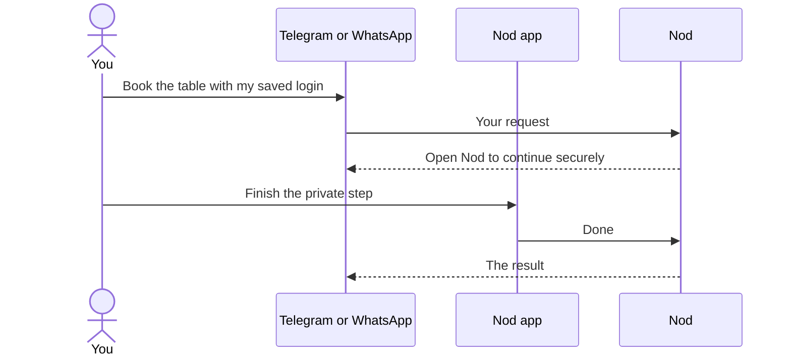

import { Steps, TabItem, Tabs } from '@astrojs/starlight/components';

You can chat with Nod from Telegram, WhatsApp or Slack. It's the same conversation, memory and tasks as in the Nod app.

With the desktop app's local assistant, channels reply only while Nod runs on an awake computer with an internet connection and the channel connected. Closing the window keeps Nod running. Quitting Nod or sleeping the computer stops live replies. Messages sent while Nod is stopped may arrive after it restarts and reconnects, but Nod does not read old WhatsApp history. If no reply appears, send the message again.

With a [self-hosted server](/deploy/self-host/), channels stay connected while the server runs. You can close the web or desktop app.

If the desktop app runs Nod, quitting it stops channel replies. The computer must stay awake. Reconnect cannot receive messages while Nod is stopped.

Nod replies in the app you wrote from. A message from Telegram gets its answer on Telegram, and a schedule you set up there sends its results there too. Everything also shows in the chat in the Nod app.

Nod uses your conversation language for pairing notices, private-step guidance and attachment recovery. Its model writes the message; an attachment's caption can help set the recovery language, but an unread attachment does not start a task. The server adds a bounded diagnostic to attachment-failure notices and removes links from them. Private sign-in and payment links stay out of chat apps.

## Before you start

|                     | Telegram                            | WhatsApp with a QR code                     |
| ------------------- | ----------------------------------- | ------------------------------------------- |
| You need            | A Telegram bot, made with BotFather | A registered WhatsApp account               |
| Works on a laptop   | Yes                                 | Yes                                         |
| Who can message Nod | Only the Telegram account you pair  | Your personal number, or your own self-chat |
| Files from Nod      | Images, documents, video and audio  | Images, documents, video and audio          |
| When Nod can write  | While Nod runs                      | While Nod runs and WhatsApp is connected    |

The QR connection does not need a Meta developer account, an API token, or a public callback address. It uses Baileys, an unofficial WhatsApp client, so there's a small risk of account restrictions, and a WhatsApp update can break the connection for a while. Nod only messages you. A separate bot number keeps your own chats safe. Check the WhatsApp terms before you connect.

Replies keep their bold text, lists, links, quotes, and code. A table arrives as one short labelled list per row. On Telegram, names of `.md`, `.py`, `.sh`, `.java`, `.zip` and `.mov` files show as code, so they don't open as web links. On WhatsApp, a literal `*`, `_` or `~` pair shows as code, so it doesn't turn into formatting. A long reply arrives as several messages. If a file doesn't arrive, open Nod to get it. When the model can't write a required notice, even on a second try, that channel message stays blocked and isn't retried later.

## Set up a channel

Open **Channels** in the sidebar, then select **Connect** on your channel. Nod checks your details before it saves them, and keeps them encrypted, outside the chat.

If Telegram or the WhatsApp Cloud API rejects setup, Nod shows the service's HTTP status and reason. If Nod can't reach the service, it says so, and names the network error when it recognizes one, such as `ECONNREFUSED` or a timeout after 15 seconds. Submitted tokens and secrets are replaced with `[redacted]`. If webhook registration fails after setup was saved, the error also states that message delivery is unconfirmed.

On a self-hosted server, leave that channel's environment variables blank or unset to use this setup. A channel configured through the environment is server-managed: edit its settings in `.env` and [apply the configuration](/deploy/configuration/#apply-configuration-changes).

<Tabs syncKey="channel">
<TabItem label="Telegram">

<Steps>

1. In **Create a bot**, scan the code or select **Open Telegram** to open [BotFather](https://t.me/BotFather). Send `/newbot`, choose a name, then a username ending in `bot`, such as `my_nod_bot`.
2. Select **I have my token**. Paste BotFather's reply, or just the token, into **Bot token**. Select **Connect bot**.
3. In **Link your account**, scan the new code or select **Open Telegram**, then press **Start** in the bot's chat. This code works for 15 minutes. On desktop, Nod opens the Telegram app when it is available. If **Start** does not connect, select **Copy pairing command** and paste the command in your bot's chat. Keep that command private.
4. In **Confirm account**, check your name and username, then select **Connect account**. Only this account can message Nod.
5. Setup closes after your account connects. Open **Manage Telegram**. Under **Chat from Telegram**, select **Open on this computer** or **Scan on phone** to open your bot's chat. Nod must be running to reply.

</Steps>

The account panel shows your bot and the name and username of the person allowed to message it, when Telegram provides them. The phone QR code opens the existing chat; it does not pair another account. Select **Disconnect Telegram** to remove the connection; Nod asks you to confirm first.

If the link doesn't work for you, select **Enter your user ID instead** and use the ID that [@userinfobot](https://t.me/userinfobot) sends you.

This setup works without a public callback URL. If your bot already uses a webhook, remove it before connecting here. To keep webhook delivery, use [Telegram webhooks in server configuration](/deploy/configuration/#telegram-webhooks).

</TabItem>
<TabItem label="WhatsApp">

<Steps>

1. Choose **Separate bot number** or **Use my own number**.
2. For a bot number, register a second number in WhatsApp or the WhatsApp Business app. Enter your personal number in Nod, with the country code and without `+` or spaces. Only your personal number can start work.
3. Read the account risk and terms. Select **Show QR code**.
4. On the phone for the account you will link, open **Settings → Linked Devices → Link a Device**. Scan the code in Nod. A code expires after one minute. The setup expires after five minutes.
5. For a bot number, message the linked number from your personal WhatsApp. For your own number, open **Message yourself** and write there.

</Steps>

Nod ignores groups, status updates, other senders and message history. In self-chat, Nod ignores its own replies. WhatsApp can hide a sender's phone number behind a private ID. With a bot number, Nod accepts these messages only when WhatsApp links the private ID to your personal number. Your other chats stay outside the Nod conversation.

The QR code updates automatically. When WhatsApp accepts the code, Nod hides it while the connection starts. If the code expires or Nod cannot check the connection, Nod hides it until a new check succeeds. Select **Start again** if setup does not continue.

Closing an unfinished setup cancels that setup. Once connected, closing the panel keeps WhatsApp connected. Nod keeps the device credentials and Signal keys encrypted on your installation. Select **Disconnect** to remove them. You can also remove Nod from **Linked Devices** on your phone. To get a new link after a sign-out, select **Reconnect**, then **Start again**.

<details>
<summary>Use the Meta Cloud API</summary>

Select **Use Meta Cloud API instead** in the setup panel. You need a Meta app with WhatsApp, a business sender number and a public HTTPS callback. Enter the business phone number ID, your personal number, the business access token and the Meta app secret. Set a webhook verification token. Save the setup, then use the same callback and token in Meta and subscribe to messages.

The Cloud API replies only within 24 hours of your last message. Its file support is limited: open Nod to get files. The QR connection supports files directly.

:::caution[Use a protected server]
Cloud API mode needs a [self-hosted server](/deploy/self-host/) with public HTTPS, or a proxy exposing only `/api/webhooks/whatsapp` from a local install. It accepts text only; use the QR connection for files and voice.
:::

</details>

</TabItem>
</Tabs>

## Slack setup

Slack uses [Socket Mode](https://docs.slack.dev/apis/events-api/using-socket-mode/). Nod opens an outbound connection, so your computer needs no public callback address. This is separate from the Slack connection in **Apps**, which gives Nod tools for Slack work.

<Steps>

1. Create a Slack app for your workspace in [Slack's app settings](https://api.slack.com/apps). Enable **Socket Mode**.
2. Create an app-level token with `connections:write`. Keep the `xapp-` token private.
3. Under **OAuth & Permissions**, add bot scopes `chat:write`, `im:write`, `im:read`, `im:history`, `users:read`, `reactions:read`, `reactions:write`, `files:read`, and `files:write`. Install the app in your workspace. Copy its `xoxb-` bot token.
4. Under **Event Subscriptions**, subscribe to bot events `message.im`, `reaction_added`, and `reaction_removed`. Enable messages in the app's **App Home**. Do not add slash commands.
5. Find your workspace ID, beginning with `T`, and use **Copy member ID** in your Slack profile menu for your own member ID.
6. In Nod, select **Channels → Connect Slack**. Enter **Bot token**, **App-level token**, **Workspace ID**, and **Your Slack member ID**. Select **Connect Slack**.
7. Open the app's direct message in Slack and send a message. Keep Nod running and your computer awake.

</Steps>

Nod verifies that both tokens belong to the same app, that the bot belongs to your selected workspace, and that your member is a human in it. It opens and verifies your one-to-one DM. Other workspaces, members, groups, shared channels, bots, and message edits don't start work or download files.

Open **Manage Slack** to reconnect, update the connection, or disconnect. Disconnect deletes Nod's saved tokens, but does not uninstall your Slack app or revoke its tokens. Environment-managed settings must be changed on the server.

### Slack replies and commands

Every Nod message arrives at the top level of the DM, not as a child in a Slack thread. To answer a question or continue a task, open the thread on that exact Nod message. Slack sends the root message, not a selected child, as the reply target. Unknown thread roots cannot answer a different question. A thumbs-up or thumbs-down reaction on a confirmation answers that exact action. Removing it does not undo an action.

This is the default connection. With **Rich Slack**, ordinary replies and task files use session threads. Approval questions still arrive separately at the top level: answer in that exact question's thread, or react to that exact question. A task thread does not select a child approval question. Partially or uncertainly delivered Slack questions cannot approve an action. An unaddressed DM reply cannot approve one either.

Slack replies use native headings, styled text, numbered and nested lists, quotes, and code where the source can be preserved safely. Compatible Markdown tables, booking facts and chart data arrive as native tables. Large tables continue in separate messages with repeated headers. Each part includes labelled text for notifications and screen readers. Empty fields, extra cells or unsupported formatting can use labelled rows or the original Markdown instead. Tables use ordinary messages, not streams. Captions use the same rendering; filenames stay literal. A definite first-message formatting rejection can use the plain equivalent instead; an uncertain or partial send is never repeated automatically. A truncation or other response warning does not count as a fully delivered question.

When Slack formatting can't keep part of a reply exactly, that part shows its original Markdown and the rest keeps its formatting. Bare web and email addresses and images stay plain text inside formatted messages; only Markdown links with a lowercase `http://`, `https://`, `mailto:` or `tel:` address and no parentheses, spaces, HTML entity or character that must be encoded become links. A paragraph, heading, list item or table cell shows its text as written when it has an HTML entity such as `&amp;`, a backslash escape, inline HTML, a reference, an angle-bracket link, or a link whose address doesn't start with lowercase `http://`, `https://`, `mailto:` or `tel:`; a heading and a table's first column stay bold. A heading with `&`, `<` or `>` arrives as bold text. A whole block shows as written when Slack formatting doesn't cover its shape, for example a quote paragraph over several lines, a list item with a second paragraph or a quote, or HTML. A whole reply shows its original Markdown and doesn't stream when it has a carriage return, a byte order mark, `<!`, `<@` or `<#` (Slack mention syntax and HTML comments), an encoded `<` or `>` such as `&lt;`, or is very large. Text with NUL or invalid Unicode is refused before sending.

Use these as ordinary DM text, not workspace slash commands:

| Send                                    | To get                                         |
| --------------------------------------- | ---------------------------------------------- |
| `nod usage`                             | Spending and app actions, with a PDF statement |
| `nod memory`                            | Memory summary and export                      |
| `nod tasks`                             | Open tasks, one message per task               |
| `nod status` in a task message's thread | That task's status                             |
| `nod stop` in a task message's thread   | Stop only that task                            |
| `nod stop` at the top level             | Stop all active work and close open tasks      |

Slack's own slash commands can have workspace-wide effects. Nod neither registers nor handles slash-command payloads.

Slack supports text, links, images, documents, video, and audio files, including audio clips. Captions stay with attachments. Outgoing audio arrives as a file, not a native Slack recording. Files are limited to 20 MB each in both directions, with the shared ten-file and 50 MB intake caps. Remote files outside Slack's private file service are not downloaded. If a file cannot be sent, open Nod to get it.

Nod transcribes incoming Slack audio on your device, even if you use a cloud voice for playback. In **Settings → Voice & audio**, select **Download** next to **On-device transcription** and wait for **Ready**. M4A and AAC audio and the first audio track of MP4, MOV and WebM video require a local FFmpeg build with support for the `fd` input protocol. On macOS and Linux, Nod looks in `/opt/homebrew/bin`, `/usr/local/bin` and `/usr/bin`. On Windows, add the local folder containing `ffmpeg.exe` to your `PATH` and restart Nod. Nod also uses FFmpeg for WebM audio when available. Clip transcription is limited to five minutes of audio. Videos with no audio track or an unsupported video format stay attached without a transcript. Nod does not send recordings to a cloud speech service; a transcript becomes part of your message to your selected chat model.

Slack has no generic bot typing indicator. Queued messages get Nod's eyes reaction until they are read. Useful progress and results arrive as ordinary messages. Standard reactions supported by Nod's channel emoji library work in both directions; custom workspace emoji and unsupported emoji are ignored. Sign-in, payments, and browser handoffs still finish privately in Nod.

Slack does offer native agent progress. Enable the optional setup below to use it; absence of a generic typing method does not mean native agent status is unavailable.

Slack lets you leave several reactions on one message. Nod tracks only your latest supported reaction; removing it clears Nod's reaction state, even if another remains visible. Removal never reverses an action.

With rich mode, Nod tracks supported reactions separately. Removing one shows your most recently added remaining reaction. This display change never approves or repeats an action. Custom emoji have no inferred meaning. Reactions missed during an outage are not reconstructed from history.

Nod resolves incomplete Slack file metadata before reading the exact file. If this fails, or the download cannot be read, Nod reports a bounded diagnostic instead of silently ignoring your message. The diagnostic distinguishes unavailable metadata, a refused download address, download failure or timeout, a preparation timeout, an HTTP response, empty bytes, a size mismatch and a voice attachment without an audio media type. It includes an HTTP status and a recognized Slack service code when available, never the file's address, name, identifiers or contents. Unknown service errors stay generic. A preparation timeout can happen during transcription; it does not identify a particular stage. A download failure does not establish a decoding or speech-setup problem.

Type the message without the file to continue. Include the diagnostic if you report the failure. Before acknowledging a Slack attachment, Nod saves its downloaded bytes and any caption in an encrypted local queue. If the download fails, Nod saves only the failure and caption for the notice. Transcription happens afterwards. After a restart, Nod resumes queued items for the same verified Slack connection without downloading them again, and does not replay them into a reset conversation. Nod removes staged content once it records the intake outcome. Rejected input with no recorded outcome can stay in the queue until it expires after 24 hours. Unreadable or expired items are not replayed. Attachments waiting for a download slot are held in memory and are not yet acknowledged. A slow download or a full queue can still delay acknowledgement, so Slack can redeliver. Duplicate deliveries do not submit the attachment twice.

For Slack audio and video, the clip size in the message can differ from the downloaded file. Nod checks the complete download and its actual size before accepting the attachment.

After a connection interruption, Nod keeps trying while Slack is configured, with failure waits increasing from two to 30 seconds. Slack's retry-after delay can extend a wait to five minutes. Connection recovery runs in the background without holding up other channels. An explicit authentication, identity, or configuration failure stops recovery until you select **Manage Slack → Reconnect**. Slack can replay recent events; Nod deduplicates saved messages and fences reaction replays. Nod does not fetch old DM history after a restart. If no reply arrives, send a new message. A message or file whose delivery is uncertain is never automatically sent again. Check Slack before asking for another attempt.

Long replies are packed into bounded messages by block, table row, or list item. Table rows retain their original column labels, and ordered lists keep their numbering. Oversized blocks split without breaking code fences, links, or escaped characters; a link too long for one part becomes plain text. A missing file message receipt leaves delivery uncertain. Nod keeps confirmed text and file targets and continues the remaining attachments without uploading any file twice.

### Rich Slack

Rich mode is optional and off by default. It uses [Agent Sessions](https://docs.slack.dev/ai/agent-sessions/) in your verified DM, not a second Nod conversation. Saved tasks keep their own Slack threads. Status reflects working, waiting for you, ready, or closed; closing a stream does not mean a task succeeded.

With rich mode, replies to your main-chat request arrive in its original Slack thread. Nod keeps that thread's identity after reconnecting or changing rich mode. Turning rich mode off sends new replies at the top level of the DM; it does not move old threads or make them answer those new messages. Several Slack threads can address your same Nod conversation. Saved tasks keep their separate threads. Unknown, foreign, closed task, and archived conversation targets fail closed. Results without an exact originating message, such as schedules created within a task, still arrive in your verified DM. They arrive unthreaded and cannot select a task or approve an action, with rich mode on or off.

An in-thread answer uses only that thread's current, fully delivered Nod message. After Stop, failure or an unavailable reply, you can make a new request in the same verified thread. It does not answer or resume the old request. Messages added while Nod works wait as separate requests when no current answer can be identified. If Nod cannot check its current work without waiting, it refuses the new request as busy; try again shortly. If Nod is waiting for an answer, approval or private code and cannot safely identify what your reply answers, it refuses rather than answering a different question. Reply to the current question or send a new direct message. Older threads without saved delivery evidence can start a new request, but cannot supply missing answer context. Approvals still need their exact, fully delivered question; codes keep their private path.

1. In your Slack app settings, declare the app as an agent with **Agent messaging experience** (`agent_view`). Add `assistant:write` alongside the scopes above. Some AI features require a paid Slack plan; settings alone do not prove availability.
2. Subscribe to `agent_session_stopped` alongside the three existing bot events. Enable **Interactivity**. Keep Socket Mode enabled; no public request URL or slash commands are needed.
3. Apply the new permissions in Slack, then select **Channels → Manage Slack → Update connection** and select **Rich Slack (requires agent setup)**. Leave unchanged fields blank to keep their saved values. If Slack changed a token, enter its replacement. For a managed connection, set `SLACK_RICH_ENABLED=true` and apply your configuration.

Switching an older `assistant_view` app to `agent_view` is irreversible. Nod does not change your Slack installation for you. **Reconnect** verifies identity again; it does not grant new scopes. Manage shows that rich mode was requested, and reports supported fallback errors without exposing credentials.

This manifest fragment supplements your app's existing identity and permissions:

```yaml
features:
  app_home:
    messages_tab_enabled: true
    messages_tab_read_only_enabled: false
  agent_view:
    agent_description: Chat with Nod in your private direct message
oauth_config:
  scopes:
    bot:
      - assistant:write
      - chat:write
      - im:write
      - im:read
      - im:history
      - users:read
      - reactions:read
      - reactions:write
      - files:read
      - files:write
settings:
  socket_mode_enabled: true
  interactivity:
    is_enabled: true
  event_subscriptions:
    bot_events:
      - message.im
      - reaction_added
      - reaction_removed
      - agent_session_stopped
```

Main-chat and task replies stream only after Nod has saved and privacy-checked the reply. This is buffered delivery, not live model-token streaming. Long replies roll over at complete Markdown block boundaries; oversized single blocks use ordinary split messages. A documented rejection that creates no stream falls back to ordinary delivery, with its specific reason in **Manage Slack**. Unknown or ambiguous failures never resend content: partial text can remain in Slack, while the saved reply remains in Nod. Private steps and approval questions never stream. Approval questions retain their separate, fully delivered message targets; replying to a conversation's parent does not approve a later question inside it.

While a main-chat or task turn is running, its controls offer **Stop** and **Status**, even before any reply text is ready. Each control is bound to that owner, installation, conversation, and exact turn. Old controls cannot stop later work or work in another channel. Native Slack Stop can cancel Nod only when its event names a still-open stream belonging to that exact active turn. Because buffered delivery usually follows model work, native Stop rarely has that binding. Empty or stale stream lists do not cancel Nod, even on a new thread; use the current turn's **Stop** control instead. Slack may stop rendering a partial stream without cancelling Nod. Working and waiting reflect Nod's saved turn state; ready means Nod can take another prompt, not that a task succeeded.

Nod saves each **Stop** or **Status** press, or native Stop, before it acknowledges it to Slack, then applies it once its checks pass. Slack's acknowledgement means Nod received the press, not that work stopped; the card shows what actually happened. A press saved before a restart, or before Slack is reconnected in Channels, is not applied afterwards. If 32 presses are already waiting or the connection is not ready, Nod doesn't acknowledge the press and Slack can show an error, so press again.

Controls expire after 15 minutes and renew while the same work is running. Disconnect invalidates them without cancelling work in other channels. A processing indicator can remain in Slack until Slack's timeout or a verified refresh clears it. Nod doesn't use removed credentials to update it.

While a main-chat turn is queued, Slack's native working indicator appears without a separate control message. Once Nod can offer **Stop**, the in-thread controls don't repeat the native working label. For longer work, the same message shows Nod's brief activity line when one is available. It updates in place and clears when work ends or waits for you. Quick replies do not get an activity line. These lines describe current work, not reasoning, tool arguments or verified results.

After an ordinary main-chat reply succeeds, Nod removes its temporary control message rather than adding a **Ready** card. Native session status still changes. Needs-you, failure and stop notices remain, as do saved task cards.

If a restart leaves task-thread or control delivery uncertain, Nod does not retry that send. Ordinary replies remain available, but that thread can lack rich controls. Check Slack and use Nod's task controls instead.

Task cards show the overall saved task state separately from plan intent. Structured plans list every entry as **Step 1**, **Step 2**, and so on, with **Pending** or **Started (reported)**. Descriptive step titles stay in Nod's ledger. Step outcomes are unverified: a reported start is not proof of continuous execution or an outside effect, and multiple steps can have reported starts. Legacy or invalid plan state is unknown; an empty structured plan says no entries were declared.

While the current task is running, an optional **Reported starts** strip shows only explicitly started entries. Pending entries remain in the complete text list. Waiting, queued work, owner corrections and ended tasks remove the native strip and keep intent as historical text. There are no native pending, completed or failed step states, percentages or inferred completion. Waiting is not success, and closing the overall task does not verify its steps. If Slack definitely rejects the new strip, Nod can remove it once while keeping the text and controls. Ambiguous delivery never creates another control message or retries the task. A view already sent can briefly remain stale until a current refresh replaces it.

Media uses Slack-hosted file uploads in the task thread; outgoing audio is a file, not a claimed native recording. A threaded file receipt without a verified parent remains uncertain. Unsupported cards, workspace policies, missing scopes, and client behavior can reduce native affordances; ordinary messages and private Nod controls remain available.

:::caution[Slack acceptance]
This channel has not yet been accepted against an owner-authorized Slack test workspace. Native formatting, nested-entity display, no-ping and automatic-link behavior, notifications and accessibility still need desktop and mobile checks, alongside workspace policy, mobile audio, file receipts, and reconnect behavior. Local rendering checks are not native Slack acceptance.
:::

<details>
<summary>Configure channels in .env instead</summary>

On a source install or self-hosted server, set the `TELEGRAM_*`, `WHATSAPP_*`, or `SLACK_*` values in [Configuration](/deploy/configuration/#channels), then [apply the configuration](/deploy/configuration/#apply-configuration-changes). Any nonempty value makes that channel server-managed. The **Channels** page cannot edit or remove its configuration, and Telegram pairing is unavailable. A managed WhatsApp QR connection still lets you scan or renew its QR code.

To configure and pair the channel in the app, clear all its environment variables and apply the configuration again. This restores any configuration previously saved through **Channels**.

</details>

## Files and voice messages

In Nod chat, audio has an inline player with a waveform, play and pause, seek, elapsed time and playback speed. The waveform is processed locally for Ogg Opus voice notes. Before decoding, Nod checks the stream, packet duration and page checksums. Long or unsupported audio can still play without a waveform.

A sticker is a conversation message, not a request to review a file. Static and animated WebP stickers, Telegram TGS animations and WebM video stickers play inline. Animations pause outside the visible chat or when the app is hidden. The reduced-motion setting stops automatic playback. TGS playback uses a local canvas in a sandbox with no network access. Invalid or oversized animations keep their original download. Telegram's thumbnail can still help the model read a sticker; it does not appear as a second message card. A sticker sent as a reply stays linked to that message.

Outside Slack, a file message sent before model setup gets a setup notice without a media download or transcription. Slack can stage the download first, but it still needs a chat model before transcribing ordinary messages. Outside Slack, if a chat model is connected but speech is not set up, Nod directs you to **Settings → Voice & audio** to connect a voice service or download free voices.

With Telegram, Slack, or the WhatsApp QR connection, send an image, document, video or audio file with your message. Captions stay with the file. Reply directly to a task message or its file to continue that task. A reply to a pending question goes to the session that asked it.

You can send a photo or file without a caption. Nod uses its content and the conversation to respond, and can ask what you want when that is unclear. It does not add a request to review the file. PNG, JPEG and WebP images reach the selected model directly when it accepts images, within the runtime's [image limits](/how-it-works/agent-runtime/#keeping-the-context-small). If that model cannot read images, Nod looks for an image model in its connected service, then in your other connected services. That model receives the images and your current request. It sends a description to the selected chat model. The chat selection stays the same. If no image model is available, the files stay in the workspace and Nod can explain the missing capability. Other files remain in the workspace for file tools.

Shared locations show their coordinates and place details in a map card. Select **View map** to load the map from [OpenStreetMap](https://www.openstreetmap.org). No map request runs before that click. A live-location share is a snapshot; Nod does not track later movements.

Shared contacts show a contact card with the name, organization, title, phone numbers, email addresses, postal addresses and website text when present. The preview reads vCard 2.1, 3.0 and 4.0. It supports folded fields, quoted parameters, and quoted-printable names. Website fields do not open automatically. The original vCard stays available to download, including extra contacts and fields that the card preview does not show. A shared location or contact is data, not permission to contact a person or change an app.

A `.vcf` reply can arrive as a native contact. Telegram supports one native card with a vCard of at most 2048 bytes; larger or grouped cards arrive as a file. A valid `location.json` reply can arrive as a native location. The [Telegram API](https://core.telegram.org/bots/api#sendcontact) defines its native contact limit.

A message usually has one file. An animated Telegram sticker can include its original file and a model-only image preview. Album files arrive as separate messages and are not combined. The shared intake has a safety cap of ten files and 50 MB; Slack can attach up to ten files. TGS previews accept Telegram's 64 KiB compressed limit, at most 4 MB after decompression, and a bounded vector structure. Telegram's hosted file API limits each incoming file to 20 MB. A voice message has a 25 MB limit, or 20 MB on Slack. Nod checks the sender before it downloads a file. Files belong to your shared conversation workspace.

Nod prepares at most four file messages at a time. If the channel is busy, send the message again after the current files finish. A caption and its transcript must fit within 100,000 characters. A failed save removes files that have no saved record.

Outside Slack, voice input reuses a connected OpenAI, OpenRouter or ElevenLabs account, or prepared on-device transcription. Downloading a voice for playback does not by itself prepare transcription. To set up on-device input, open Nod Chat and select the microphone. Choosing a local voice keeps transcription local; choosing a direct ElevenLabs voice uses that connection. Otherwise, Nod uses an available OpenAI connection, then OpenRouter, then ElevenLabs, then prepared local models. A connection marked as needing attention is not used. If you have several keys for the same provider, select the connection you want to use. A ChatGPT or Claude subscription alone does not include cloud speech. Source installs can also use `OPENAI_API_KEY` or `OPENROUTER_API_KEY` after the connection is validated. Nod selects one service before sending audio; a failed request does not send the recording to another service.

`STT_MODEL` selects the transcription model. The default is `gpt-transcribe` for OpenAI and `openai/gpt-transcribe` for OpenRouter. For OpenRouter, use a full model ID from its [transcription catalog](https://openrouter.ai/models?fmt=cards&output_modalities=transcription). A model ID without `/` gets the `openai/` prefix on OpenRouter. Text-only chat models cannot transcribe audio. Without speech setup, Nod asks you to send text. Text and file messages still work.

Use text to approve an action. A file or voice attachment does not approve it.

When Nod drafts a bug report, reply "send" to share its summary. A diagnostic report can only be added from the card in Nod on your computer. See [Report a bug](/use/chat/#report-a-bug).

Ask Nod for a voice reply to get the answer as audio. On the WhatsApp QR connection, OpenAI voices arrive as a voice note and OpenRouter or ElevenLabs voices as an audio message. WhatsApp can't play WAV in the chat, so free local voices and other audio formats arrive as a file you can open. Choose a voice in **Settings → Voice & audio**, using a connected OpenAI, OpenRouter or ElevenLabs account, or downloaded free voices. `TTS_MODEL` and `TTS_VOICE` set the default OpenAI speech model and voice. Speech calls have usage records. Voice replies stop at the monthly spending limit; transcribing your own voice message doesn't, so you can still ask Nod to change the limit by voice. OpenRouter reports the transcription cost. Where OpenAI returns supported usage, Nod calculates an API-price estimate. A speech response without a known price shows **No price** in Usage.

Nod sends files up to 50 MB each, or 20 MB on Slack. Large or unavailable files stay available in Nod. Long replies are split into messages. Telegram and WhatsApp show typing status while work runs.

For a short reply with one image, video or document, the text is its caption. Longer replies, voice replies and replies with several files send the text in a separate message.

## Connection and delivery

Nod saves the WhatsApp device keys encrypted in its database. The keys stay on the server. They do not enter the model, sandbox, analytics or chat. The QR code is available only in the private setup panel and is not saved in channel settings.

After a restart or network loss, Nod uses the saved link to connect again. Replies that have not started sending wait while WhatsApp is disconnected. A send with an unclear result is not repeated automatically. This prevents duplicate messages; check Nod if a reply does not arrive.

If messages stop, open **Channels** and select **Reconnect** for Telegram or WhatsApp. Nod restarts message delivery with the saved settings. It keeps your paired Telegram account and saved WhatsApp device keys. A saved Telegram webhook is registered again. Telegram polling errors show the service's status and reason on this page.

**Reconnect** also works for server-managed channels. Their settings still come from the server environment. For WhatsApp, the connection panel opens after reconnecting. If WhatsApp has signed out the device, select **Start again** and scan a new code.

Telegram can change its update numbers after seven days without messages. Nod stops using the saved update number after 24 hours without a received update. Telegram keeps pending updates for 24 hours.

The Channels page checks status every five seconds while visible. During Telegram pairing, or with the WhatsApp connection panel open, it checks every two seconds. **Connecting** means WhatsApp is trying to reconnect. **Connection failed** shows a stopped connection and its reason. WhatsApp errors distinguish a signed-out device, a replaced connection, a rejected session or device version, an incorrect bot account, and local storage or message errors. The connection panel shows the same reason. Connection failures also enter the local diagnostic log, without WhatsApp phone numbers, QR codes, or device keys. When the QR connection ignores an incoming WhatsApp message, the log records only a fixed reason, the connection mode, how WhatsApp addressed the chat (phone number, private ID or other), and how many similar messages it skipped. It records each reason and addressing type at most once a minute. The log never includes the message, the sender, or any number or ID.

## Answer approval questions

In Telegram, tap **Approve** or **Cancel** below a new approval question. If the question appears without buttons, reply directly to it with yes or no. If it spans more than one message, reply to one of them, including the reply guidance. In WhatsApp, reply directly to the question. See [how approvals work](/trust/approvals/).

Approval buttons work automatically in Telegram polling mode. If you set up a Telegram webhook in Nod before buttons were available, open **Channels** and select **Reconnect**. For a webhook you registered yourself, [update the Telegram webhook registration](/deploy/configuration/#telegram-webhooks).

## Private steps happen in the Nod app

Passwords, saved logins, app sign-ins and payment approvals never go through a chat app. When a task started on Telegram or WhatsApp needs one, Nod asks you to open Nod. Finish the step there, and the task carries on and replies in the chat app.

Links to this computer and to Nod's private pages stay out of chat apps too. Nod removes the ones it finds. It also checks each link, image and address the way Markdown reads it, with encoded characters decoded. If one points to this computer (`localhost`, `127.0.0.1` and similar local addresses) or to a private Nod page, the chat app gets a short note to open Nod instead of the reply.



If a website sends you a one-time sign-in code, you can send it by itself in the chat where Nod asked. Nod uses it for that sign-in and keeps it out of its chat history. Card security codes work only in the Nod app. See [Vault](/trust/vault/) and [Payments](/trust/payments/).

A direct reply must name the current sign-in question. A reply to a closed or unknown question cannot send a code to another sign-in request.

Taking over [Nod's browser](/use/browser/) also needs the Nod app, because chat apps can't show the page.

## While Nod works

While Nod works on something you asked for in this chat, including a task it started for you, you see **typing…**.

- **Telegram** adds a quoted progress section when a task's first message or chat's opening message arrives as one short text message. Named steps use your conversation language. Without a named step, a running labeled tool appears as **Using Gmail**, **Using Slack**, or **Using local files**. The same fallback applies to other apps, websites, and MCP servers. Known tools without a label, such as code, commands and web searches, appear by their kind of work, such as **Running code** or **Searching the web**. These fallbacks, and the note shown while Nod retries a failed model request, are in English. The section updates quietly in place and disappears when work stops. The answer arrives separately. You can keep typing and sending messages, or reply to the first message to correct the task. Long or split messages, attachments, visual cards, files and private sign-in or payment links keep typing status only.
- **WhatsApp** shows **typing…** while connected. The Meta Cloud API also marks your latest message as read and stops typing after its 24-hour reply window closes. The QR connection has no reply window.
- **A message you send while Nod works** gets a 👀 reaction in both apps until Nod reads it, so you know it's queued. Nod leaves its own reaction to that message alone.

Typing stays on through slow steps without extra messages. Work Nod starts on its own, such as a reply your notification rule asks for, shows no typing.

Nod still sends real messages for its opening line, useful milestones or partial results, questions, blockers, the final result and failures. If work stops on an error, Nod says what stopped it. Live status can continue while those messages arrive. See [Message cadence](/how-it-works/agent-runtime/#message-cadence).

## Reactions

Reactions work both ways, as they do in the [Nod app](/use/chat/#react-to-messages).

- **Nod's reactions.** Nod sometimes reacts to your message with an emoji, such as ❤️ when you thank it or 🎉 for good news. A reaction comes on top of Nod's reply, never instead of it. On Telegram, Nod uses only Telegram's standard reactions.
- **Your reactions.** React to any Nod message, and Nod saves the reaction for Nod to interpret as a response to that message. A 👍 or 👎 on an action confirmation confirms or declines that exact action. Other reactions can answer questions; Nod asks for confirmation before acting outside chat. Your reactions also show on the original message in the Nod app, including reactions to later parts of a long reply, without adding another chat bubble. Removing a reaction does not undo a response or action already sent.

If a reaction send fails, its result can be unclear. Nod keeps the attempt and does not send it again. You can ask Nod to remove it. A failed removal keeps the previous reaction.

A Telegram webhook must include `message_reaction` in its allowed update types to pass your reactions to Nod. For an environment-managed channel, follow [Telegram webhooks](/deploy/configuration/#telegram-webhooks) to register it again. For a channel configured in the app, select **Connect bot** again in the channel settings. A bot that polls for messages, such as in the desktop app, already requests reactions.

## Commands

These commands prepare a report without starting a task. Your selected model writes the short summary in your conversation language, and that model call counts toward usage. The export is generated directly from your saved data.

| Send      | To get                                                      |
| --------- | ----------------------------------------------------------- |
| `/usage`  | This month's spending and app actions, with a PDF statement |
| `/memory` | A short summary of what Nod remembers, with the full export |

Telegram and the WhatsApp QR connection receive the PDF and export as documents. With the WhatsApp Cloud API, open Nod to get them.

Both channels have task controls. `/tasks` lists open tasks, with one message per task. Reply to a task message with `/status` to see its goal, steps and state, or `/stop` to stop only that task. `/stop` without a reply stops all active work and closes open tasks. Progress, questions and results stay linked to the same task. See [Track tasks](/use/tasks/#telegram-and-whatsapp-without-a-task-page).

## Related resources

- [Host your own server](/deploy/self-host/)
- [Chat with Nod](/use/chat/)
- [Spending and usage](/use/spending/)
- [Memory](/use/memory/)
- [Vault and saved logins](/trust/vault/)
- [Your data and privacy](/trust/privacy/)
